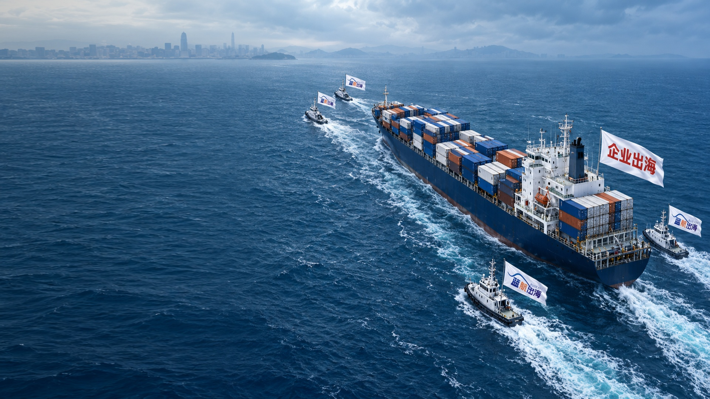

# 蓝航船队循环视频交付

10 秒 · 1920×1080 · 30fps · 无音轨。MP4 使用 H.264，WebM 使用 VP9。

## 下载

- [MP4 视频](deliverables/bluevoy-fleet-loop.mp4)
- [WebM 视频](deliverables/bluevoy-fleet-loop.webm)
- [完整工程包 ZIP（含全部成品、素材与源码）](deliverables/bluevoy-fleet-source.zip)
- [封面 JPG](deliverables/poster.jpg)
- [动画预览 GIF](deliverables/preview.gif)
- [网站背景嵌入示例](deliverables/index.html)
- [验证结果](deliverables/validation.json)

打开文件页面后使用 Download raw file 下载；也可用仓库 Code → Download ZIP 下载整个仓库。

## 实现和限制

这是二维分层照片动画：船体与货柜保持稳定，海面、尾流与旗面独立动画。保留原旗帜纹理，远处 Logo 清晰度受原图限制。未加入船体起伏、薄雾动画或真实泡沫粒子模拟。为了留出左侧40%文案空间，重新拼接海面并在水平方向压缩原图至80%。没有倒放、往返运动或循环交叉淡化。

两个视频均已完整解码验证：300帧、10秒、1920×1080、30fps、无音轨。未压缩动画的周期端点一致，H.264压缩后首尾接缝平均像素差约1/255。

## 编辑和运行

见 [source/README.md](source/README.md)。源码目录下执行 `python3 render.py`，输出到该目录内的 `output/`。原始输入文件位于 `source/assets/`。无需收费外部 API。
